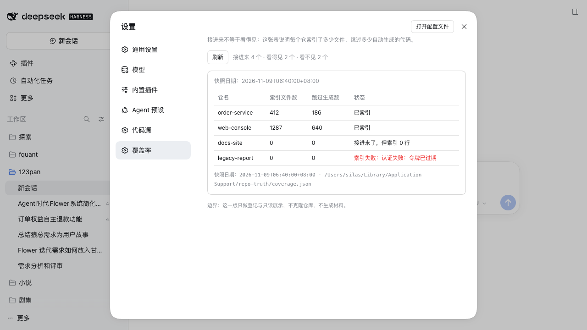

# repo-truth

**给产品经理看的「系统现状」：一条命令，把任意公开仓库变成一页能读的东西。**
*A product-manager-readable "current state" of a code repo — one command, one static page.*

[示例①：Vue 后台模板](examples/vue-admin-template-status.html) · [示例②：Next.js 订阅站（App Router）](examples/nextjs-subscription-payments-status.html)

> 这是一份自动生成的「系统现状」：只写能从代码里量出来的东西，不写设计意图，也不写应该做成什么样。当前能读懂的代码文件 76 个，合计约 97 KB。按语言分，JavaScript 38 个、Vue 25 个、CSS 6 个、JSON 2 个，其余 3 种语言合计 5 个。
>
> —— 上面这段是 [`examples/vue-admin-template-status.html`](examples/vue-admin-template-status.html) 的正文原文，一个字都没有改。

```bash
# 60 秒看任意公开仓（需要 node 22+ 和 git）
npx dsh-plugin-repo-truth demo https://github.com/PanJiaChen/vue-admin-template.git
# ✓ 已写入：./vue-admin-template-status.html
```

**代码不出你的机器**：浅克隆到系统临时目录，量完即删；不装依赖、不执行仓库里的脚本、不把源码发给任何模型或服务。全程只有一次 `git clone --depth 1`。

装上 dsh 之后（插件形态）：

```bash
dsh plugin --profile <你的 profile> add dsh-plugin-repo-truth   # 非 Electron 管理的 profile 走这条正路
```

---

## 这一页是怎么来的（也是它的边界）

`demo` 只做四件量得到的事：按语言数文件、按目录约定列页面、数界面模块被引用了几次、找最大与最近改动的文件。
量不到的（后端流程、数据结构、权限、线上请求链路、页面跳转关系）**一个字段都不编**，并且在页面上写成一段显式限界：

> **读不懂**：`.weird` × 1。这些文件不计入上面的任何数字，也不参与任何判断——它们既不算「读到了」，也不该被读成「不存在」。
>
> **页面口径**：只按目录约定识别，没有解析跳转声明文件。所以「清单里没有某个页面」只代表**没找到**，不代表**不存在**。

三种状态永远分开写：**读不到 / 没找到 / 待确认**。把「没查到」写成「不存在」，是这类系统最常见也最贵的错。

## 署名：默认带，可以关

每张生成的页面上都有两个东西，都从 `lib/branding.js` 一个模块出（版本号从 `package.json` 现读，不写第二遍）：

| 位置 | 内容 | 默认 | 能关吗 |
|---|---|---|---|
| 页面底部 | `由 repo-truth 生成 · https://github.com/repo-truth/repo-truth-plugin · v0.2.0` | 开 | 能，`attribution: false` |
| `<head>` | `<meta name="generator" content="repo-truth v0.2.0">` | 永远在 | 不能——它是元数据，不是品牌 |

`attribution` 写在插件配置里（`config.json` 顶层），也可以用命令行开关临时覆盖：

```json
{ "version": 1, "attribution": false, "hosts": [] }
```

```bash
npx dsh-plugin-repo-truth demo <仓地址> --no-attribution   # 本次不带页脚，meta 保留
```

为什么允许关：企业内部分发材料时，页面上出现外部项目地址可能过不了合规审查；拒绝这个开关，等于把这类用户挡在门外。
为什么 meta 不跟着关：出问题时要能从 HTML 本身认出「这是哪个版本生成的」，这跟品牌无关。

<!-- 折叠线以下：给装插件、改插件的人看 -->

---

## 它作为 dsh 插件能干什么

- **登记代码源**：名称、基础地址、类型（GitLab / GitHub / 通用）、访问令牌。可以添加、编辑、删除。
- **测试连接**：拿这行配置实际打一次对方的只读接口，回答「通不通」和「看得见几个仓库」：
  - GitLab → `GET {baseUrl}/api/v4/projects?per_page=1&membership=true`，读 `X-Total`
  - GitHub → `GET {baseUrl}/user/repos?per_page=1`，读 `Link: …rel="last"`
  - 通用 → `GET {baseUrl}`，只说通不通，不猜仓库数
  - 失败一律给中文原因：令牌无效 / 权限不足 / 地址不对 / 连不上 / 超时 / 证书校验失败
- **配置落盘**：`~/Library/Application Support/repo-truth/config.json`，目录 `700`、文件 `600`；
  界面上令牌永远只显示掩码（`glpat-…1234`），接口返回里也只有掩码。
- **覆盖率表（只读）**：读 `~/Library/Application Support/repo-truth/coverage.json`，渲染
  仓名 / 索引文件数 / 跳过生成数 / 状态，并在顶部给出「接进来 N 个 · 看得见 M 个 · 看不见 K 个」。




界面文案全中文。写这套东西的纪律来自 `repo-to-pm-truth` 那个 skill：**读不到 / 没找到 / 待确认 三件事永不合并成一句**。

## 它不干什么（边界）

- **不长期持有仓库**：`demo` 会浅克隆到系统临时目录，读完立刻删（`--keep-temp` 是唯一例外）。
  插件本体（设置页那半边）不克隆、不索引、不建库。
- 不改代码、不建分支、不在远端创建任何东西。测试连接只有一次 `GET`，demo 只有一次 `clone --depth 1`。
- 不做权限体系：谁能打开这个 dsh 的界面，谁就能看到这些配置（令牌仍是掩码）。
- 不做多用户/多机同步。配置就是这台机器上的一个文件。
- 覆盖率表**只读**。插件不写 `coverage.json`——写它的是后面的索引切片。

## 怎么装

### 方式一：装进现有 profile（桌面版）

桌面版的 `desktop` profile 被 Electron 独占，CLI 的 `dsh plugin` 会拒绝（`error: profile "desktop" is managed exclusively by the Electron application`），
所以要手改两个文件。**不需要重启应用**：`dsh-hmr` 会热重组。

```bash
PLUGIN=$(pwd)                                  # ← 在这个仓库根目录里执行
cd ~/.dsh/profiles/desktop
cp package.json      package.json.bak-repo-truth
cp cordis.patch.yml  cordis.patch.yml.bak-repo-truth

node -e "const fs=require('fs');const p=JSON.parse(fs.readFileSync('package.json','utf8'));
p.dependencies['dsh-plugin-repo-truth']='link:' + process.env.PLUGIN;
if(!p.dsh.profile.bundles.includes('dsh-plugin-repo-truth')) p.dsh.profile.bundles.push('dsh-plugin-repo-truth');
fs.writeFileSync('package.json',JSON.stringify(p,null,2))"

ln -sfn "$PLUGIN" node_modules/dsh-plugin-repo-truth
```

几秒后自检（`200` = 宿主半边已挂上，`401` = 还没挂上，请求落进了 `/api` 的鉴权闸门）：

```bash
curl -s http://127.0.0.1:60425/api/repo-truth/health
```

**卸载（完全可逆）**

```bash
cd ~/.dsh/profiles/desktop
cp package.json.bak-repo-truth      package.json
cp cordis.patch.yml.bak-repo-truth  cordis.patch.yml
rm node_modules/dsh-plugin-repo-truth
```

### 方式二：自建一个 profile（不动桌面 app）

```bash
P=~/.dsh/profiles/repo-truth-gui
mkdir -p "$P/node_modules"
cp ~/.dsh/profiles/web/{cordis.yml,cordis.patch.yml,pnpm-workspace.yaml} "$P/"
cat > "$P/package.json" <<'JSON'
{ "name": "dsh-profile-repo-truth-gui", "private": true,
  "dependencies": { "dsh-plugin-repo-truth": "link:/绝对路径/repo-truth-plugin" },
  "dsh": { "profile": { "bundles": [
    "@deepseek-ai/dsh-base", "@deepseek-ai/dsh-web-app", "dsh-plugin-repo-truth" ] } } }
JSON
ln -sfn /绝对路径/repo-truth-plugin "$P/node_modules/dsh-plugin-repo-truth"

node "/Applications/DeepSeek Harness.app/Contents/Resources/app/dsh/node_modules/@deepseek-ai/dsh/lib/bin.js" \
  --profile repo-truth-gui --no-open --port 60555
```

终端会打印一行 `dsh web: http://127.0.0.1:60555/?token=…`，用浏览器打开这个带 token 的地址即可。

### 方式三：非 Electron 管理的 profile（CLI 正路）

```bash
dsh plugin --profile <profile> add /绝对路径/repo-truth-plugin
```

它会往 profile 里写 `link:` 依赖并把它选进 bundles，需要 pnpm（首次会走 corepack 下载）。

## 怎么开发

零构建依赖：`lib/client.js` 是**手写的模块图 bundle**（只调用 `window.__ModuleLoader__.load`），
改完保存，`dsh-client-hmr` 会在约 500ms 的轮询后发现 bundle 变了，把新版本换进已打开的页面，**不用刷新**。
宿主半边（`lib/index.js` 及其 import 的 `lib/*.js`）改了要等配置热重组或重启宿主。

```bash
npm test                          # 16 个用例：署名行为、正文禁词、demo 端到端、宿主回写
node --check lib/client.js        # 浏览器半边语法
node bin/dsh-plugin-repo-truth.js --help
```

模块分工（改哪一处很清楚）：

| 文件 | 干什么 |
|---|---|
| `lib/branding.js` | 署名：页脚、meta、版本、项目地址。版本只从这里读 `package.json` |
| `lib/scan.js` | 扫描：语言分布、页面约定、模块引用、最大/最近改动文件、读不懂的扩展名 |
| `lib/render.js` | 渲染：正文产品语言 + 限界框 + 末尾「研发参考」，并带正文禁词自检函数 |
| `lib/demo.js` | 浅克隆 → 扫描 → 渲染 → 写盘 → 删临时目录 |
| `bin/dsh-plugin-repo-truth.js` | `npx dsh-plugin-repo-truth demo …` 的入口 |

重新生成 `examples/`（公开仓，任选，跑完把 HTML 提交进去）：

```bash
node bin/dsh-plugin-repo-truth.js demo https://github.com/PanJiaChen/vue-admin-template.git --out examples
node bin/dsh-plugin-repo-truth.js demo https://github.com/vercel/nextjs-subscription-payments.git --out examples
```

## 配置文件长什么样

`~/Library/Application Support/repo-truth/config.json`（**这台机器上唯一存令牌的地方**，`600`）

```json
{
  "version": 1,
  "hosts": [
    { "name": "主代码平台", "baseUrl": "https://git.example.com", "kind": "gitlab", "token": "glpat-…" }
  ]
}
```

`attribution: false` 是可选的顶层键（不写就是开）。写入是「临时文件 + rename」的原子替换，写完强制 `600`。

## 覆盖率文件长什么样

`~/Library/Application Support/repo-truth/coverage.json`（**插件只读，不写**）

```json
{
  "generatedAt": "2026-11-09T06:40:00+08:00",
  "repos": [
    { "repo": "order-service", "filesIndexed": 412, "filesSkippedGenerated": 186, "ok": true,  "headDate": "2026-11-08" },
    { "repo": "docs-site",     "filesIndexed": 0,   "filesSkippedGenerated": 0,   "ok": true,  "headDate": "2025-03-02" },
    { "repo": "legacy-report", "filesIndexed": 0,   "filesSkippedGenerated": 0,   "ok": false, "error": "认证失败：令牌已过期" }
  ]
}
```

也接受顶层数组。几处刻意的设计：

- `filesIndexed: 0` 且 `ok: true` 显示成**「接进来了，但索引 0 行」**——「接进来」不等于「看得见」。
- `ok: false` 必须带 `error`，界面上原样显示中文原因；失败也要出现在表里，不许消失。
- 没有文件时写**「没找到覆盖率文件：<路径>」**，不写「没有仓库」——「没查到」不是「不存在」。

## 接口

| 方法 | 路径 | 说明 |
|---|---|---|
| GET | `/api/repo-truth/health` | 自检：插件在不在、版本、署名开关、数据目录在哪 |
| GET | `/api/repo-truth/config` | 代码源列表（令牌只有掩码）+ 署名开关 |
| POST | `/api/repo-truth/hosts` | 新增或修改（带 `originalName` 即为修改；`token` 留空 = 沿用旧令牌） |
| POST | `/api/repo-truth/hosts/delete` | 删除一条 |
| POST | `/api/repo-truth/test` | 测试连接；`token` 留空时按 `name` 取已保存的令牌 |
| GET | `/api/repo-truth/coverage` | 覆盖率（只读） |

## 安全说明

- 令牌只出现在两个地方：`config.json`（`600`）和宿主进程内存里。不进浏览器存储、不进日志、不进响应。
- 错误文案会先把令牌替换成掩码再返回（兜住底层「回显请求头」的情况）。
- 插件的路由不在 `/api` 的鉴权闸门后面（`/api/repo-truth` 是最长前缀，绕过了 `/api`）。
  这是 dsh 的路由匹配规则决定的，所以：**只有宿主监听在 loopback 时才是安全的**。把 `host` 改成对外地址前必须先加鉴权。

## 许可证

MIT，见 [LICENSE](LICENSE)。

插件怎么被加载的完整实测记录（profile / HMR / manifest / 槽位，含失败现场）见
[docs/how-plugins-load.md](docs/how-plugins-load.md)。
