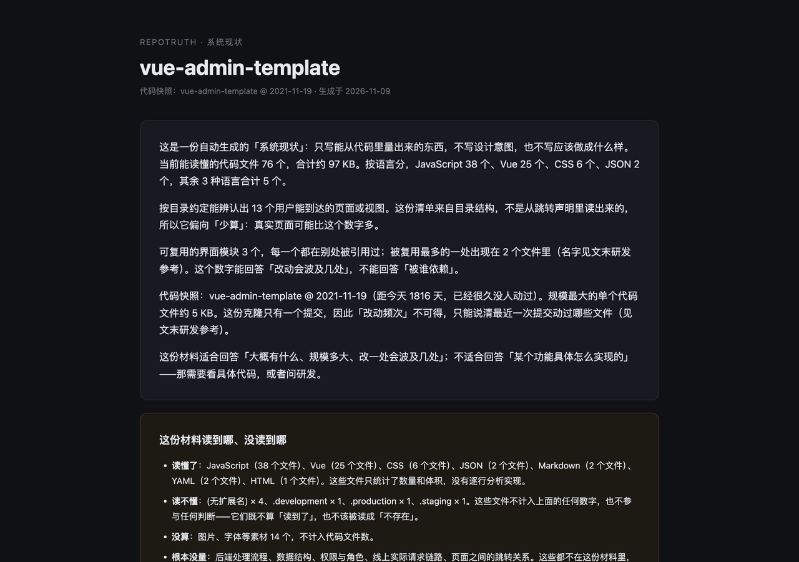
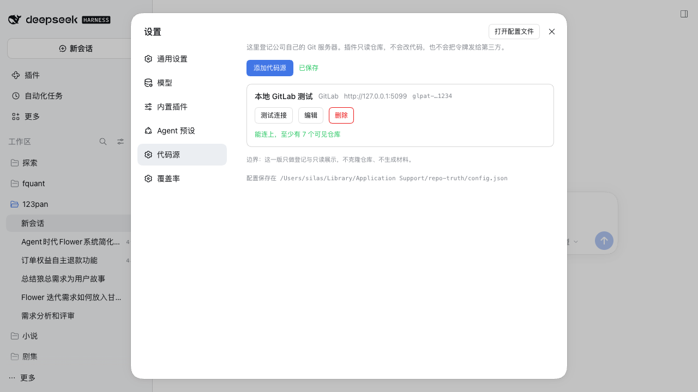
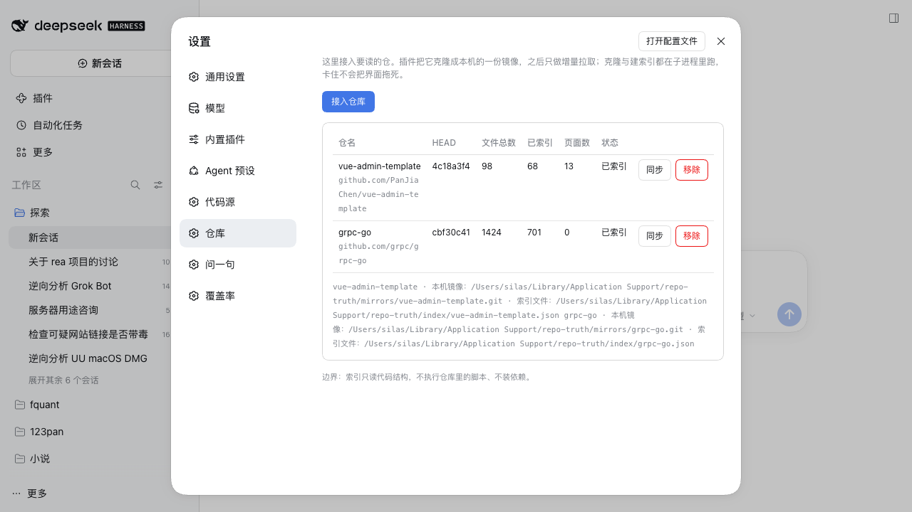
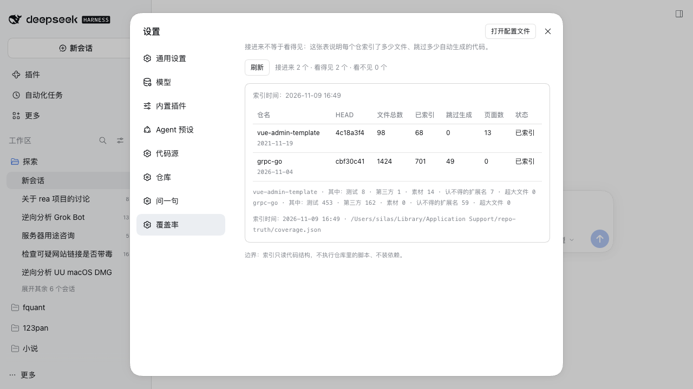

# repotruth

**评审会上有人问「这个功能现在是怎么实现的」，然后全屋人开始等研发翻代码。**

repotruth 把代码仓库变成一句句**能被代码核实**的话：有哪些页面、每页由什么组成、改一处会波及几处、这段代码多久没人动过。

*Turn code repositories into system status a product manager can read. Every sentence is traceable to code — and says so when it isn't.*



```bash
# 60 秒看任意公开仓（需要 node 22+ 和 git）
npx dsh-plugin-repotruth demo https://github.com/PanJiaChen/vue-admin-template.git
# ✓ 已写入：./vue-admin-template-status.html
```

打开它，看到的是这样一段话（**正文原文，一个字没改**）：

> 这是一份自动生成的「系统现状」：只写能从代码里量出来的东西，不写设计意图，也不写应该做成什么样。当前能读懂的代码文件 **76 个**，合计约 **97 KB**。按语言分，JavaScript 38 个、Vue 25 个、CSS 6 个、JSON 2 个，其余 3 种语言合计 5 个。
>
> 按目录约定能辨认出 **13 个**用户能到达的页面或视图。这份清单来自目录结构，不是从跳转声明里读出来的，**所以它偏向「少算」：真实页面可能比这个数字多**。
>
> **读不懂**：(无扩展名) × 4、`.development` × 1。这些文件不计入上面的任何数字，也不参与任何判断——**它们既不算「读到了」，也不该被读成「不存在」。**

更多示例：[Vue 后台模板](examples/vue-admin-template-status.html) · [Next.js 订阅站（App Router）](examples/nextjs-subscription-payments-status.html)

**代码不出你的机器**：浅克隆到系统临时目录，量完即删；不装依赖、不执行仓库里的脚本、不把源码发给任何模型或服务。

## 为什么做这个

产品经理判断一个需求值不值得做、有多大、会不会捅到别处，靠的是「现在到底是怎么实现的」。这个答案通常存在三个地方：**某个研发的脑子、一个三年前的群聊、或者一段没人读完的代码。**

让 agent 读代码很容易。难的是**让它别编**。绝大多数「AI 帮你分析代码」的工具，会用同样自信的语气说出这四句话：

- 一个根本不存在的页面
- 一个早已重构掉的接口
- 把框架自动生成的代码，说成「产品已有的能力」
- 把「我没找到」说成「不存在」

repotruth 的全部设计，都在对抗这四件事。

## 它回答什么，不回答什么

| 能回答 | 不能回答 |
| --- | --- |
| 产品里有哪些页面，每页由哪些模块组成 | 为什么当初这么设计 |
| 改一个模块会波及几处 | 线上真实发生了什么（要看日志 / 埋点） |
| 这段代码多久没人动过 | 这段代码好不好 |
| 你提的这件事，代码里有没有对应实现 | 该不该做这件事 |

**它给的是证据，不是结论。** 判断仍然是人做的。

## 三句话纪律

材料里每个结论都只可能是这三种之一，**永远不合并**：

```
代码没读到，这一轮不含任何现状判断。        ← 我没看
读到了代码，但历史没读到，因此不含判断。    ← 看了一半
没能在代码里定位到这条需求的实现。          ← 查过，没找到 ≠ 不存在
```

---

## 一条链路，四步

| 步骤 | 在界面上 | 干了什么 | 产出 |
|---|---|---|---|
| 1 接入 | 设置 → 仓库 → 接入仓库 | 把仓克隆成本机 bare 镜像；之后只 `fetch`，不重克隆 | `mirrors/<仓名>.git` |
| 2 建索引 | 同一个按钮，进度自己走 | 列树 → 只解析没见过的内容块 → 写一份 JSON | `index/<仓名>.json` |
| 3 问一句 | 设置 → 问一句 | 用一句中文问，只查本机索引回答 | `answers/<id>.html` + 面板里的正文 |
| 4 覆盖率 | 设置 → 覆盖率 | 每个仓「接进来 / 看得见 / 看不见」的账 | `coverage.json` |

克隆与建索引都跑在**独立子进程**里，每个仓一套硬超时。宿主进程从头到尾不等它们——
卡在 DNS、卡在凭据提示、卡在一个几十万文件的树里，界面照样能用，到点自动杀。

## 建索引：按内容寻址，不用数据库

```
data/index/<仓名>.json
{
  "head": "<sha>", "indexedAt": "<iso>",
  "blobs": { "<blobSha>": { "lang", "symbols", "outline", "pages", "imports" } },
  "files": { "<路径>": "<blobSha>" },
  "generated": { "<blobSha>": true }, "sizes": {…}, "changes": {…}, "counts": {…}
}
```

- **同一个内容只解析一次**。第二遍跑同一个 HEAD 必须**解析 0 个内容块**——这条是测试守着的，不是注释。
  实测：98 个文件的仓首轮 4.5 秒，第二轮 **100 ms、0 解析**。
- **跳过的东西要记账**：`vendor/`、`third_party/`、`testdata/`、测试文件、`Code generated … DO NOT EDIT.`
  全部排除，并且按仓分别计数——覆盖率表里「已索引」和「跳过生成」是两列。
- **页面口径只有一份实现**（`lib/scan.js`）：demo 与索引都调它，所以两边不会给出两个页面数。

## 问一句：查不到就说查不到

界面上输入一句中文，例如「用户登录页面是怎么做的？」，得到的是：

- 哪些页面/视图的名字与它相关（产品语言，例如「login」），以及这一片有多大；
- 有多少个模块引用过它们（改一处会波及几处）；
- 最近一次改动是哪天，代码快照是哪天的；
- 一段显式限界：读了什么、跳过什么、**「没找到 ≠ 不存在」**。

检索是笨的（词面 + 中文二元组 + 一张固定的中文↔英文对照表），但**不会编**：
没有命中就写「没找到」，并把查过的仓、文件数、检索词原样列出来，不给「最像的那个」。
材料里没有一个字来自对实现逻辑的阅读——它只读索引。

## 覆盖率表：接进来 ≠ 看得见

```
仓名 / HEAD / 文件总数 / 已索引 / 跳过生成 / 页面数 / 状态
接进来 N 个 · 看得见 M 个 · 看不见 K 个
```

实测（两个公开仓，本机跑出来的数）：

| 仓 | HEAD | 文件总数 | 已索引 | 跳过生成 | 页面数 | 状态 |
|---|---|---|---|---|---|---|
| vue-admin-template | `4c18a3f4` | 98 | 68 | 0 | 13 | 已索引 |
| grpc-go | `cbf30c41` | 1424 | 701 | 49 | 0 | 已索引 |

「看不见」的那些去哪了，表下面还有一行分项：测试、第三方目录、素材、认不得的扩展名、超大文件。
`filesIndexed: 0` 且成功，显示成**「接进来了，但索引 0 行」**——接进来不等于看得见。

## 署名：默认带，可以关

每张生成的页面上都有两个东西，都从 `lib/branding.js` 一个模块出（版本号从 `package.json` 现读，不写第二遍）：

| 位置 | 内容 | 默认 | 能关吗 |
|---|---|---|---|
| 页面底部 | `由 repotruth 生成 · https://github.com/SilasSolivagus/dsh-repotruth · v0.3.0` | 开 | 能，`attribution: false` |
| `<head>` | `<meta name="generator" content="repotruth v0.3.0">` | 永远在 | 不能——它是元数据，不是品牌 |

`attribution` 写在插件配置里（`config.json` 顶层），也可以用命令行开关临时覆盖：

```json
{ "version": 1, "attribution": false, "hosts": [] }
```

```bash
npx dsh-plugin-repotruth demo <仓地址> --no-attribution   # 本次不带页脚，meta 保留
```

为什么允许关：企业内部分发材料时，页面上出现外部项目地址可能过不了合规审查；拒绝这个开关，等于把这类用户挡在门外。
为什么 meta 不跟着关：出问题时要能从 HTML 本身认出「这是哪个版本生成的」，这跟品牌无关。

<!-- 折叠线以下：给装插件、改插件的人看 -->

---

## 它作为 dsh 插件能干什么

- **登记代码源**：名称、基础地址、类型（GitLab / GitHub / 通用）、访问令牌。可以添加、编辑、删除。
- **测试连接**：拿这行配置实际打一次对方的只读接口，回答「通不通」和「看得见几个仓库」：
  - GitLab → `GET {baseUrl}/api/v4/projects?per_page=1&membership=true`，读 `X-Total`
  - GitHub → `GET {baseUrl}/user/repos?per_page=1`，读 `Link: …rel="last"`
  - 通用 → `GET {baseUrl}`，只说通不通，不猜仓库数
  - 失败一律给中文原因：令牌无效 / 权限不足 / 地址不对 / 连不上 / 超时 / 证书校验失败
- **从代码源里挑仓库**：`/source-repos` 与「测试连接」用的是同一份请求拼装代码（`hostApiRequest`），
  所以不会出现「测试连接通、列仓库 404」。只发只读 `GET`。
- **接入仓库**：填完整地址，或 `owner/name`（按代码源的地址规则拼）；同名仓自动加 `-2`，绝不覆盖已有索引。
- **同步**：首次 `git clone --mirror`，之后 `git fetch --prune`。进度靠面板轮询 `/jobs`（不开 websocket）。
- **移除**：从登记表删掉，并删掉本机镜像与索引文件（只删我们自己的 `mirrors/`、`index/` 下的东西）。
- **问一句**：只读本机索引出材料，正文产品语言 + 限界框 + 末尾折叠的研发参考 + 署名。
- **覆盖率表**：由索引运行结果生成，不是 fixture 文件。







界面文案全中文。写这套东西的纪律来自 `repo-to-pm-truth` 那个 skill：**读不到 / 没找到 / 待确认 三件事永不合并成一句**。

## 它不干什么（边界）

- **不改代码**：只有克隆、`fetch`、`ls-tree`、`cat-file`、`log`、`rev-parse`。没有 `push`、没有建分支、没有写远端。
  也**永远不会**在这个仓库或任何工作区里跑 `git clean` / `checkout --` / 删未跟踪文件——本工具只处理自己 `mkdtemp` 出来的目录和自己 `mirrors/` 下的镜像。
- **不装依赖、不执行仓库里的脚本**。索引只做文本解析。
- **不做完整语义理解**：不做 AST、不解析路由声明文件、不读后端流程。所以「清单里没有」只代表**没找到**。
- **不做跨仓内容复用**：每个仓一份索引文件，同样的内容在两个仓里会各算一次（见 `docs/how-the-chain-works.md` 的未做清单）。
- **不做权限体系**：谁能打开这个 dsh 的界面，谁就能看到这些配置（令牌仍是掩码）。
- **不做多用户/多机同步**。配置就是这台机器上的几个文件。

## 怎么装

### 方式一：装进现有 profile（桌面版）

桌面版的 `desktop` profile 被 Electron 独占，CLI 的 `dsh plugin` 会拒绝
（`error: profile "desktop" is managed exclusively by the Electron application`），
所以要手改两个文件。**不需要重启应用**：`dsh-hmr` 会热重组。

```bash
PLUGIN=$(pwd)                                  # ← 在这个仓库根目录里执行
cd ~/.dsh/profiles/desktop
cp package.json      package.json.bak-repotruth
cp cordis.patch.yml  cordis.patch.yml.bak-repotruth

node -e "const fs=require('fs');const p=JSON.parse(fs.readFileSync('package.json','utf8'));
p.dependencies['dsh-plugin-repotruth']='link:' + process.env.PLUGIN;
if(!p.dsh.profile.bundles.includes('dsh-plugin-repotruth')) p.dsh.profile.bundles.push('dsh-plugin-repotruth');
fs.writeFileSync('package.json',JSON.stringify(p,null,2))"

ln -sfn "$PLUGIN" node_modules/dsh-plugin-repotruth
```

几秒后自检（`200` = 宿主半边已挂上，`401` = 还没挂上，请求落进了 `/api` 的鉴权闸门）：

```bash
curl -s http://127.0.0.1:60425/api/repo-truth/health
```

**卸载（完全可逆）**

```bash
cd ~/.dsh/profiles/desktop
cp package.json.bak-repotruth      package.json
cp cordis.patch.yml.bak-repotruth  cordis.patch.yml
rm node_modules/dsh-plugin-repotruth
```

### 方式二：自建一个 profile（不动桌面 app）

```bash
P=~/.dsh/profiles/repotruth-gui
mkdir -p "$P/node_modules"
cp ~/.dsh/profiles/web/{cordis.yml,cordis.patch.yml,pnpm-workspace.yaml} "$P/"
cat > "$P/package.json" <<'JSON'
{ "name": "dsh-profile-repotruth-gui", "private": true,
  "dependencies": { "dsh-plugin-repotruth": "link:/绝对路径/dsh-repotruth" },
  "dsh": { "profile": { "bundles": [
    "@deepseek-ai/dsh-base", "@deepseek-ai/dsh-web-app", "dsh-plugin-repotruth" ] } } }
JSON
ln -sfn /绝对路径/dsh-repotruth "$P/node_modules/dsh-plugin-repotruth"

node "/Applications/DeepSeek Harness.app/Contents/Resources/app/dsh/node_modules/@deepseek-ai/dsh/lib/bin.js" \
  --profile repotruth-gui --no-open --port 60555
```

终端会打印一行 `dsh web: http://127.0.0.1:60555/?token=…`，用浏览器打开这个带 token 的地址即可。
（本机验证用的是 `~/.dsh/profiles/repo-truth-gui`，profile 名与目录名不参与包解析，见 `docs/how-plugins-load.md`。）

### 方式三：非 Electron 管理的 profile（CLI 正路）

```bash
dsh plugin --profile <profile> add /绝对路径/dsh-repotruth
```

## 怎么开发

零构建依赖：`lib/client.js` 是**手写的模块图 bundle**（只调用 `window.__ModuleLoader__.load`），
改完保存，`dsh-client-hmr` 会在约 500ms 的轮询后发现 bundle 变了，把新版本换进已打开的页面，**不用刷新**。
宿主半边（`lib/index.js` 及其 import 的 `lib/*.js`）改了要等配置热重组或重启宿主。

```bash
npm test                          # 46 个用例：署名、正文禁词、demo 端到端、增量契约、超时、问一句、命名一致性
node --check lib/client.js        # 浏览器半边语法
node bin/dsh-plugin-repotruth.js --help
node scripts/mutation-check.mjs    # 变异验证：每条规则「改坏就变红」，15/15
```

模块分工（改哪一处很清楚）：

| 文件 | 干什么 |
|---|---|
| `lib/branding.js` | 署名：页脚、meta、版本、项目地址。版本只从这里读 `package.json` |
| `lib/scan.js` | 扫描的**纯函数层**：语言判定、页面约定、组件名、单文件解析；`scanRepo` 是工作区适配器 |
| `lib/render.js` | demo 的渲染：产品语言正文 + 限界框 + 末尾「研发参考」，带正文禁词自检 |
| `lib/git.js` | 所有 git 调用（只读），含中文错误翻译与超时判定 |
| `lib/indexer.js` | 增量建索引：列树 → 只解析新内容块 → 写 JSON |
| `lib/worker.js` | 子进程入口：克隆/拉取 + 建索引，按行汇报进度 |
| `lib/jobs.js` | 任务：起子进程、收进度、硬超时杀进程组 |
| `lib/repos.js` | 登记表与覆盖率表的唯一写者 |
| `lib/ask.js` | 检索：词表、打分、阈值、命中与「没找到」 |
| `lib/answer.js` | 问一句的渲染：正文 + 限界框 + 研发参考 + 署名 |
| `lib/demo.js` | 浅克隆 → 扫描 → 渲染 → 写盘 → 删临时目录 |
| `bin/dsh-plugin-repotruth.js` | `npx dsh-plugin-repotruth demo …` 的入口 |

重新生成 `examples/`（公开仓，任选，跑完把 HTML 提交进去）：

```bash
node bin/dsh-plugin-repotruth.js demo https://github.com/PanJiaChen/vue-admin-template.git --out examples
node bin/dsh-plugin-repotruth.js demo https://github.com/vercel/nextjs-subscription-payments.git --out examples
```

## 数据目录长什么样

`~/Library/Application Support/repo-truth/`（目录 `700`，文件一律 `600`）

```
config.json      代码源（唯一存令牌的地方）+ 署名开关
repos.json       已接入的仓：地址、上次 HEAD、上次同步结果
coverage.json    覆盖率表（由索引运行结果生成，插件自己写）
mirrors/<仓名>.git    bare 镜像；只 fetch，不重克隆
index/<仓名>.json     内容寻址索引；删掉可重放
answers/<id>.html     「问一句」的材料（自动只留最近 60 份）
```

`config.json`：

```json
{
  "version": 1,
  "hosts": [
    { "name": "主代码平台", "baseUrl": "https://git.example.com", "kind": "gitlab", "token": "glpat-…" }
  ]
}
```

写入是「临时文件 + rename」的原子替换，写完强制 `600`。

## 接口

| 方法 | 路径 | 说明 |
|---|---|---|
| GET | `/api/repo-truth/health` | 自检：版本、署名开关、数据目录 / 镜像目录 / 索引目录 |
| GET | `/api/repo-truth/config` | 代码源列表（令牌只有掩码）+ 署名开关 |
| POST | `/api/repo-truth/hosts` | 新增或修改代码源（带 `originalName` 即为修改；`token` 留空 = 沿用旧令牌） |
| POST | `/api/repo-truth/hosts/delete` | 删除代码源 |
| POST | `/api/repo-truth/test` | 测试连接 |
| GET | `/api/repo-truth/source-repos?name=<代码源>` | 列出该代码源上可见的仓库（只读） |
| GET | `/api/repo-truth/repos` | 已接入的仓 + 当前任务 |
| POST | `/api/repo-truth/repos` | 接入一个仓（`url` 或 `owner/name`），立即开跑 |
| POST | `/api/repo-truth/repos/sync` | 手动同步（同一个仓并发时返回 409 + 中文原因） |
| POST | `/api/repo-truth/repos/delete` | 移除仓，并删本机镜像与索引 |
| GET | `/api/repo-truth/jobs?id=&repo=` | 任务列表 / 单个任务（面板轮询这个） |
| POST | `/api/repo-truth/ask` | 问一句；返回正文、限界框、候选、材料 URL |
| GET | `/api/repo-truth/answers/<id>.html` | 打开那份材料 |
| GET | `/api/repo-truth/coverage` | 覆盖率表（只读） |

## 安全说明

- 令牌只出现在两个地方：`config.json`（`600`）和宿主进程内存里。不进浏览器存储、不进日志、不进响应。
- 克隆需要令牌时，令牌经 **stdin** 一次性递给子进程（不进 argv——`ps` 能看到整条命令行），
  子进程只把它塞进 git 的 `GIT_CONFIG_VALUE_0`（`http.extraHeader`），绝不打印。
- 错误文案会先把令牌替换成掩码再返回（兜住底层「回显请求头」的情况）。
- 插件的路由不在 `/api` 的鉴权闸门后面（`/api/repo-truth` 是最长前缀，绕过了 `/api`）。
  这是 dsh 的路由匹配规则决定的，所以：**只有宿主监听在 loopback 时才是安全的**。把 `host` 改成对外地址前必须先加鉴权。

## 致谢

材料的呈现层（规范流程图、三栏联动走查页、时序图）来自 **[roxorlt/UEmaster](https://github.com/roxorlt/UEmaster)**（MIT）—— 那是这个项目思路的起点：先让评审「看得见」，再让评审「看得懂」。感谢 [@roxorlt](https://github.com/roxorlt)。

## 许可证

MIT，见 [LICENSE](LICENSE)。

这条链路的数据布局、接口清单、增量契约与检索规则，见 [docs/how-the-chain-works.md](docs/how-the-chain-works.md)；
插件怎么被加载的完整实测记录见 [docs/how-plugins-load.md](docs/how-plugins-load.md)。
